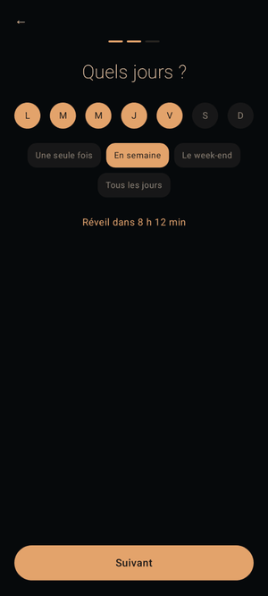
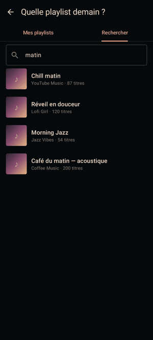
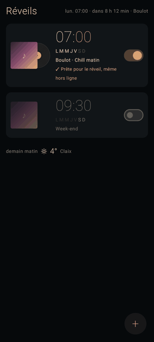
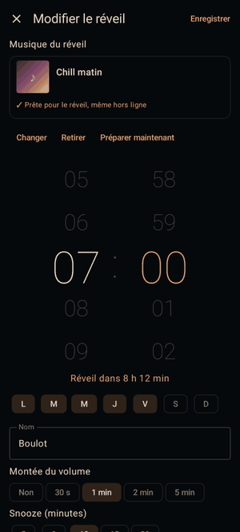
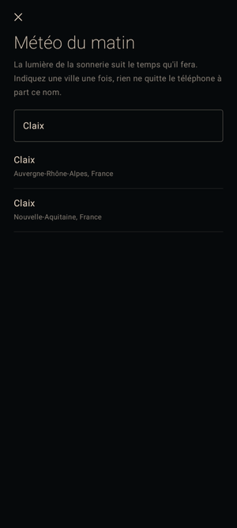
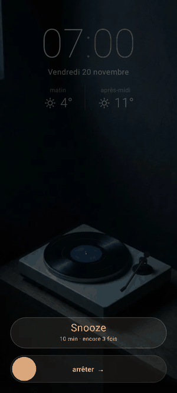
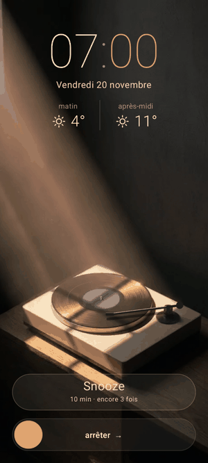
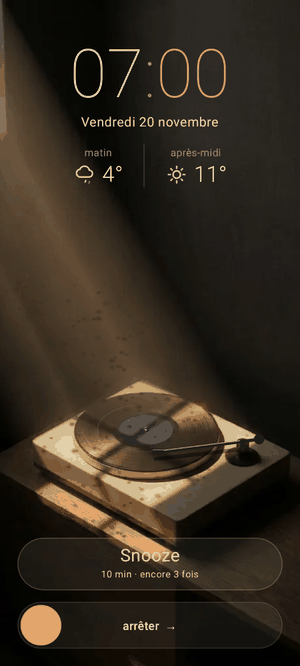
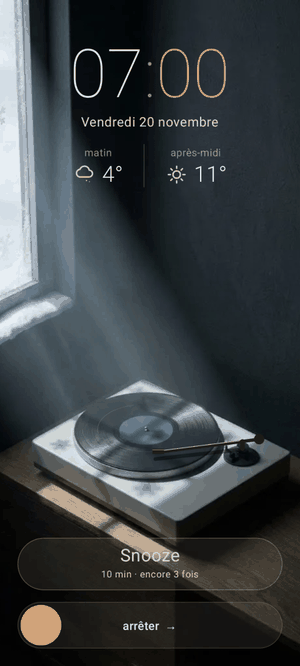

# Réveil Playlist

Un réveil Android qui vous réveille avec **votre playlist YouTube Music, en aléatoire**, sans abonnement. La lumière du matin entre doucement dans la pièce pendant que le volume monte, et le bras de la platine se pose sur le disque.

<p align="center">
  
</p>
<p align="center"><a href="docs/sonnerie.mp4">▶ Voir la vidéo (MP4)</a></p>

## Installer

1. Téléchargez le dernier `reveil-playlist-X.Y.Z.apk` dans les [Releases](../../releases/latest).
2. Ouvrez-le sur le téléphone et autorisez l'installation depuis votre navigateur ou gestionnaire de fichiers.
3. Au premier lancement, autorisez les notifications et l'affichage plein écran : c'est ce qui permet au réveil de sonner écran verrouillé.

L'app n'est pas sur le Play Store (elle lit YouTube Music via [NewPipeExtractor](https://github.com/TeamNewPipe/NewPipeExtractor)). Elle **se met à jour toute seule** : quand une nouvelle version est publiée ici, un bandeau « Nouvelle version disponible · Installer » apparaît en haut de la liste.

## Comment ça marche

### 1. Créer un réveil en trois questions

L'heure, les jours, puis la playlist. Le récapitulatif dit dans combien de temps il sonnera.

<p align="center">
  
  
  
</p>

<p align="center">
  
</p>

### 2. Choisir la playlist

Connectez votre compte YouTube Music pour retrouver vos playlists, ou cherchez-en une. Un lien collé ou partagé depuis l'app YouTube Music fonctionne aussi. La pochette choisie voyage d'un écran à l'autre jusqu'à sa place dans la liste.

<p align="center">
  
  
  
</p>

### 3. La liste des réveils

Chaque réveil est une pochette : le disque sort quand il est activé. En haut, le prochain réveil et dans combien de temps. Toucher un réveil l'ouvre pour régler le nom, la montée du volume, le snooze ou préparer la musique tout de suite.

<p align="center">
  
  
  
</p>

### 4. Le réveil

La pièce est dans la nuit quand la musique commence, tout bas. Le volume monte, un premier rayon rose apparaît, puis le soleil entre par la fenêtre. La météo du matin et de l'après-midi s'affiche sous l'heure, et la lumière suit le temps qu'il fait : soleil, nuages, pluie ou neige. Glissez « arrêter » pour couper, ou touchez Snooze.

<p align="center">
  
  
  
  
  
</p>

### 5. Même sans réseau

- La veille au soir, 15 morceaux de la playlist sont téléchargés et renouvelés au fil des réveils. Au réveil, l'app joue d'abord ceux-là, puis passe au streaming.
- Un morceau qui ne démarre pas en 10 s est sauté. Après 3 échecs de suite, la sonnerie d'alarme du téléphone prend le relais : **le réveil sonne toujours**.
- Le réveil se déclenche à l'heure même en veille profonde, et se reprogramme après un redémarrage ou un changement d'heure.
- Arrêt automatique au bout de 30 minutes.

### 6. Mises à jour

<p align="center">
  
</p>

L'app interroge les releases de ce dépôt. La première fois, Android demande d'autoriser Réveil Playlist à installer ses mises à jour, ensuite c'est un bouton.

## Publier une version

Monter `versionName` et `versionCode` dans `app/build.gradle.kts`, puis fusionner sur `main`. Le workflow [`release.yml`](.github/workflows/release.yml) compile, signe l'APK et publie la release `vX.Y.Z` si elle n'existe pas encore. Secrets nécessaires : `KEYSTORE_BASE64`, `KEYSTORE_PASSWORD`, `KEY_ALIAS`.

## Contribuer

Les contributions passent par des pull requests sur `main`. Personne ne pousse directement sur `main` : chaque fusion peut publier une version.

1. **Une PR = un changement.** Une fonctionnalité, un bug ou un refactor, pas les trois. Une petite PR se relit en dix minutes ; au-delà de ~400 lignes modifiées, découpez.
2. **Partez d'une branche à jour** de `main`, nommée par le sujet (`fix/sonnerie-secours`, `feat/meteo-vent`).
3. **Le comportement d'abord, en scénario.** Toute règle nouvelle ou corrigée s'écrit en `.feature` français (Soit / Quand / Alors), sans parler du code. Lancez-le et regardez-le échouer avant d'écrire le code. Pas d'étape vide ni « en attente ».
4. **Un bug = un test qui le reproduit.** Expliquez la cause dans la PR, ajoutez le scénario qui échoue pour la bonne raison, puis corrigez la cause, pas le symptôme.
5. **La logique va dans `core`**, testable sans téléphone. `app` ne fait que brancher Android.
6. **Tout est vert en local avant d'ouvrir la PR** :
   ```sh
   ./gradlew detekt :core:test :core:koverVerify :app:lintDebug :app:verifyPaparazziDebug
   ```
   Couverture ≥ 95 % en lignes et en branches, aucun avertissement detekt ou lint, fichiers sous 5 000 tokens (le hook `scripts/hooks` le vérifie).
7. **Un changement visible montre son résultat.** Si l'écran change, enregistrez les captures (`:app:recordPaparazziDebug`), commitez-les et mettez un avant / après (capture ou GIF) dans la PR.
8. **Textes de l'app en français, au vouvoiement**, sans tiret cadratin.
9. **Décrivez la PR** avec le modèle proposé : pourquoi, ce qui change, comment c'est testé, captures. Liez l'issue (`Fixes #12`).
10. **Ne changez pas la version** dans une PR de contribution : c'est la PR de release qui monte `versionName` / `versionCode`.

La relecture regarde, dans l'ordre : le contexte, la justesse, la sécurité, les performances, la lisibilité, l'architecture, les tests. Répondez à chaque commentaire (corrigé, ou pourquoi pas) plutôt que de les résoudre en silence. La CI (`check.yml`) relance linters, tests et couverture sur chaque PR ; elle est fusionnée en *squash* quand la CI est verte et qu'une relecture l'a approuvée.

## Architecture

| Module | Rôle |
| --- | --- |
| `core` | Kotlin pur, sans Android : planification, gestion, snooze, lien de playlist, file aléatoire, supervision de lecture, politique de pré-téléchargement. Testé en BDD. |
| `app` | Adaptateurs Android fins : AlarmManager, service de premier plan (Media3/ExoPlayer, `USAGE_ALARM`), NewPipeExtractor, WorkManager, UI Compose. |

L'extraction passe par [NewPipeExtractor](https://github.com/TeamNewPipe/NewPipeExtractor) derrière l'interface `PlaylistSource` : on peut la remplacer par yt-dlp (youtubedl-android) si YouTube casse l'extracteur.

## Tests et qualité

- Scénarios Gherkin en français dans `core/src/test/resources/features`, exécutés par un petit runner maison (`core/src/test/kotlin/.../bdd`). Une étape non définie ou ambiguë fait échouer le scénario.
- Couverture Kover sur `core` : minimum 95 % en lignes et en branches (`./gradlew :core:koverVerify`).
- detekt avec complexité cyclomatique ≤ 6, Android lint avec avertissements bloquants.
- Hook pré-commit : `git config core.hooksPath scripts/hooks` (refuse les fichiers > 5 000 tokens, lance linters, tests et couverture).

```sh
./gradlew detekt :core:test :core:koverVerify :app:lintDebug :app:assembleDebug
```

## Limites connues

- La couche Android n'a que des captures d'écran automatisées (Paparazzi) : le reste se vérifie sur un téléphone (voir la recette ci-dessous).
- YouTube change régulièrement son site ; si l'extraction casse, mettre à jour NewPipeExtractor. La sonnerie de secours garantit que le réveil sonne quand même.
- Les alarmes ne sonnent pas entre un redémarrage et le premier déverrouillage du téléphone.

## Recette sur téléphone

1. Installer l'APK, autoriser les notifications et l'affichage plein écran (bannière en haut de la liste).
2. Créer une alarme avec un lien de playlist, appuyer sur « Tester » : la musique démarre, l'écran de réveil s'affiche.
3. Appuyer sur « Préparer maintenant », attendre une minute, passer en mode avion, puis « Tester » : un morceau en cache est joué.
4. Mode avion sans cache (nouvelle playlist) : la sonnerie système retentit.
5. Régler une alarme dans 2 minutes, verrouiller l'écran : l'écran de réveil s'allume.
