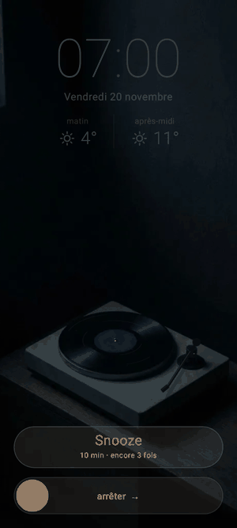

# Réveil Playlist

Un réveil Android qui vous réveille avec **votre playlist, en aléatoire**. La lumière du matin entre doucement dans la pièce pendant que le volume monte.

  

<a href="docs/sonnerie.mp4">▶ Voir la vidéo</a>

## Installer

Il faut Android 9 ou plus.

  

1. Sur le téléphone, touchez **Télécharger**, puis le fichier **`.apk`**.
2. Ouvrez-le. Si Android bloque, activez **« Autoriser cette source »**.
3. Si Play Protect alerte, touchez **« Plus de détails »** puis **« Installer quand même »**.
4. Ouvrez l'app et touchez **« Autoriser »** sur chaque ligne.

## Mises à jour

L'app vous prévient. Touchez **« Installer »** dans le bandeau.

## En savoir plus

- [Installer pas à pas, avec images](docs/INSTALLATION.md), si vous bloquez.
- [Comment ça marche](docs/FONCTIONNEMENT.md) : créer un réveil, choisir la playlist, la météo, le réveil sans réseau.
- [Contribuer](CONTRIBUTING.md) : le code, les tests, l'architecture.
