# Comment ça marche

## 1. Créer un réveil en trois questions

L'heure, les jours, puis la playlist. Le récapitulatif dit dans combien de temps il sonnera.

  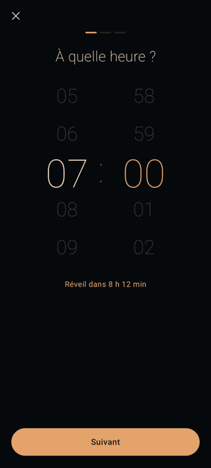
  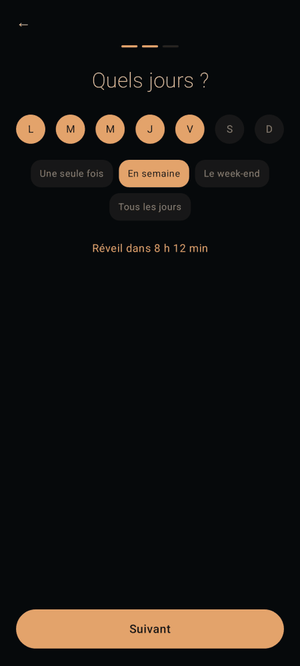
  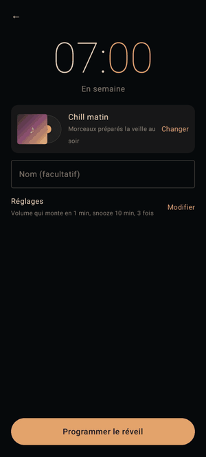

  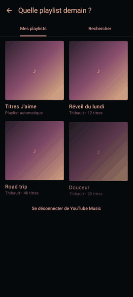

## 2. Choisir la playlist

Connectez votre compte YouTube Music pour retrouver vos playlists, ou cherchez-en une. Un lien collé ou partagé depuis l'app YouTube Music fonctionne aussi. La pochette choisie voyage d'un écran à l'autre jusqu'à sa place dans la liste.

  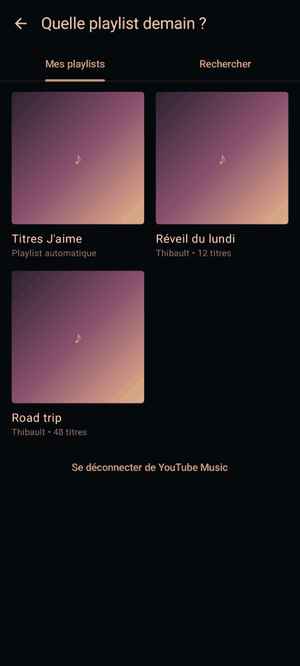
  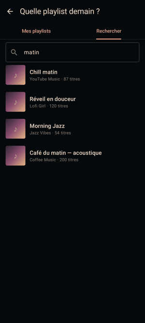
  

## 3. La liste des réveils

Chaque réveil est une pochette : le disque sort quand il est activé. En haut, le prochain réveil et dans combien de temps. Toucher un réveil l'ouvre pour régler le nom, la montée du volume, le snooze ou préparer la musique tout de suite.

  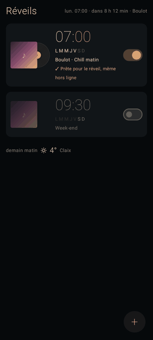
  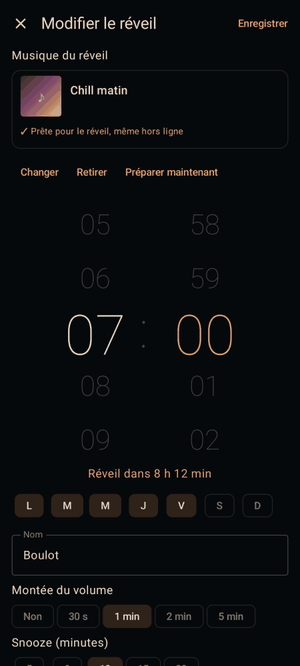
  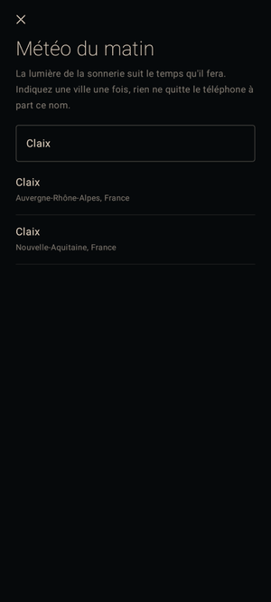

## 4. Le réveil

La pièce est dans la nuit quand la musique commence, tout bas. Le volume monte, un premier rayon rose apparaît, puis le soleil entre par la fenêtre. La météo du matin et de l'après-midi s'affiche sous l'heure, et la lumière suit le temps qu'il fait : soleil, nuages, pluie ou neige. Glissez « arrêter » pour couper, ou touchez Snooze.

  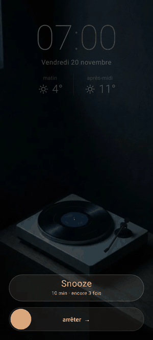
  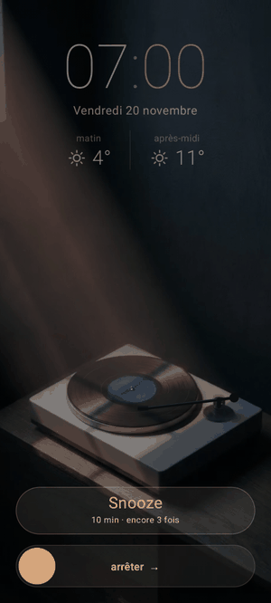
  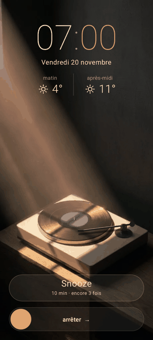
  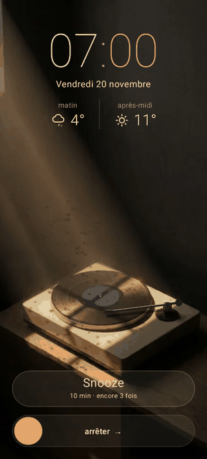
  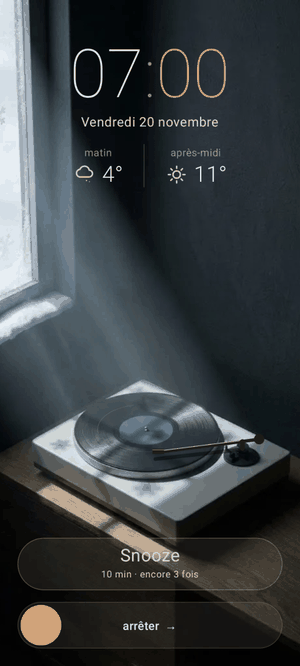

## 5. Même sans réseau

- La veille au soir, 15 morceaux de la playlist sont téléchargés et renouvelés au fil des réveils. Au réveil, l'app joue d'abord ceux-là, puis passe au streaming.
- Un morceau qui ne démarre pas en 10 s est sauté. Un morceau dont le lien est introuvable est sauté tout de suite. Après 3 échecs de suite, la sonnerie d'alarme du téléphone prend le relais, et si elle-même ne peut pas jouer, l'alarme système d'Android : **le réveil sonne toujours**.
- Le réveil se déclenche à l'heure même en veille profonde, et se reprogramme après un redémarrage ou un changement d'heure.
- Arrêt automatique au bout de 30 minutes.
- Si le téléchargement du soir échoue entièrement, il est retenté plus tard ; lancé à la main (« Préparer maintenant »), l'échec s'affiche.

## 6. Mises à jour

  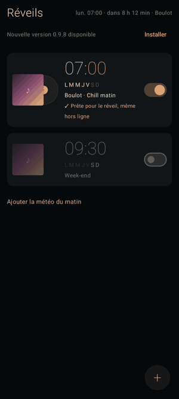

L'app interroge les releases de ce dépôt. Quand une nouvelle version sort, un bandeau « Installer » apparaît en haut de la liste et une notification discrète la signale. « Installer » télécharge la nouvelle version dans l'app, avec sa progression. Quand elle est prête, « Ouvrir » affiche les téléchargements, et Android l'installe quand on touche le fichier (voir [Mettre à jour](INSTALLATION.md#5-mettre-à-jour)). L'app ne demande pas la permission d'installer des applications : Play Protect bloque les apps qui l'ont.

[← Retour](../README.md)
