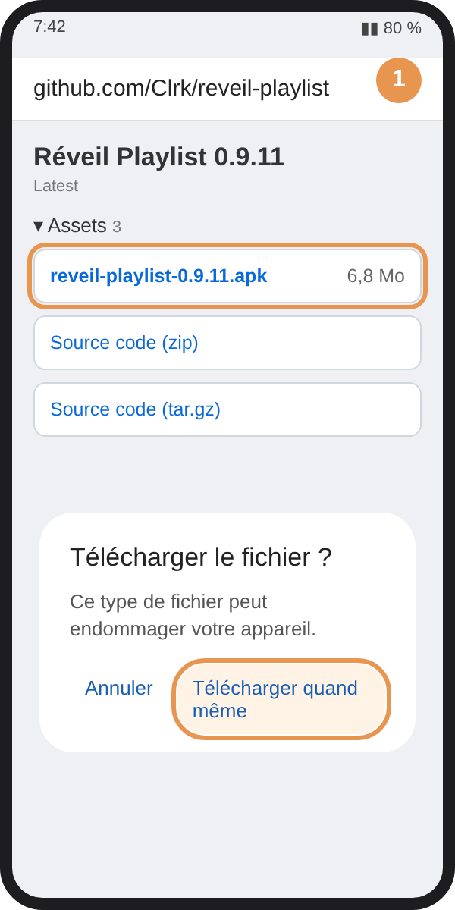
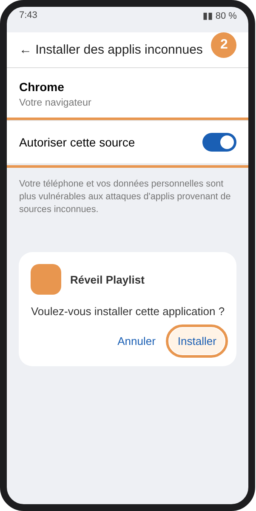
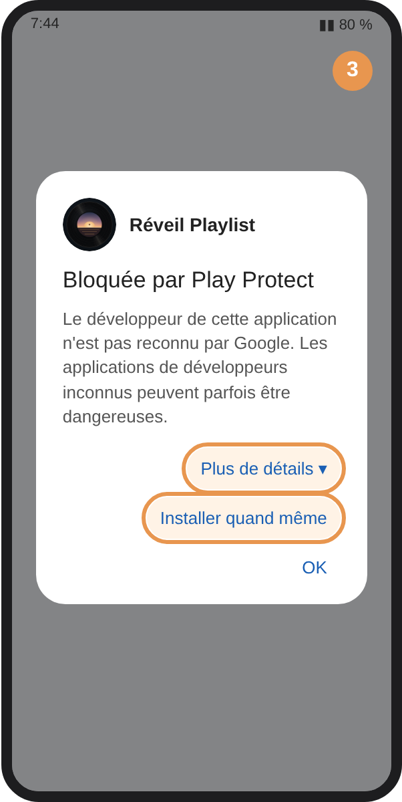
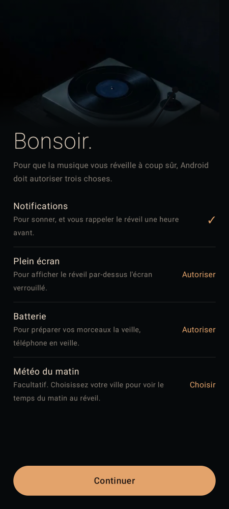

# Installer Réveil Playlist

L'app n'est pas sur le Play Store.
Vous l'installez vous-même, une seule fois.
Il faut un téléphone Android 9 ou plus récent.

  
  
  

Les mots peuvent changer un peu selon votre téléphone.

## 1. Télécharger

1. Sur le téléphone, touchez [**Télécharger l'app**](https://github.com/Clrk/reveil-playlist/releases/latest/download/reveil-playlist.apk).
2. Touchez **« Télécharger quand même »**.

## 2. Installer

1. Touchez **« Ouvrir »** quand le téléchargement est fini.
2. Android bloque l'installation. Touchez **« Paramètres »**.
3. Activez **« Autoriser cette source »**.
4. Revenez en arrière.
5. Touchez **« Installer »**.

## 3. Passer l'alerte Play Protect

Google ne connaît pas l'app. Il peut afficher une alerte.

1. Touchez **« Plus de détails »**.
2. Touchez **« Installer quand même »**.

L'app est sans danger : tout son code est public ici.

## 4. Ouvrir l'app

  

L'app demande 3 autorisations.
Elles servent à faire sonner le réveil à coup sûr.

1. Touchez **« Autoriser »** sur chaque ligne :
   - **Notifications** : pour sonner.
   - **Plein écran** : pour afficher le réveil quand le téléphone est verrouillé.
   - **Batterie** : pour préparer la musique la nuit.
2. Vous pouvez choisir votre ville pour la météo. C'est facultatif.
3. Touchez **« C'est parti »**.

## 5. Mettre à jour

1. Un bandeau **« Nouvelle version disponible »** apparaît en haut de l'app.
2. Touchez **« Installer »**. L'app télécharge la nouvelle version.
3. Quand c'est prêt, touchez **« Ouvrir »**, puis le fichier.
4. La première fois, Android bloque : activez **« Autoriser cette source »** pour l'app Fichiers.
5. Touchez **« Mettre à jour »**.

Vos réveils sont gardés.
L'app ne se met jamais à jour toute seule.

## Un problème ?

- **Le fichier ne s'ouvre pas** : ouvrez l'app **Fichiers**, puis **Téléchargements**.
- **« Application non installée »** : libérez de la place, puis téléchargez à nouveau.
- **Le réveil ne s'affiche pas écran verrouillé** : touchez le bandeau en haut de l'app.

[← Retour](../README.md)
